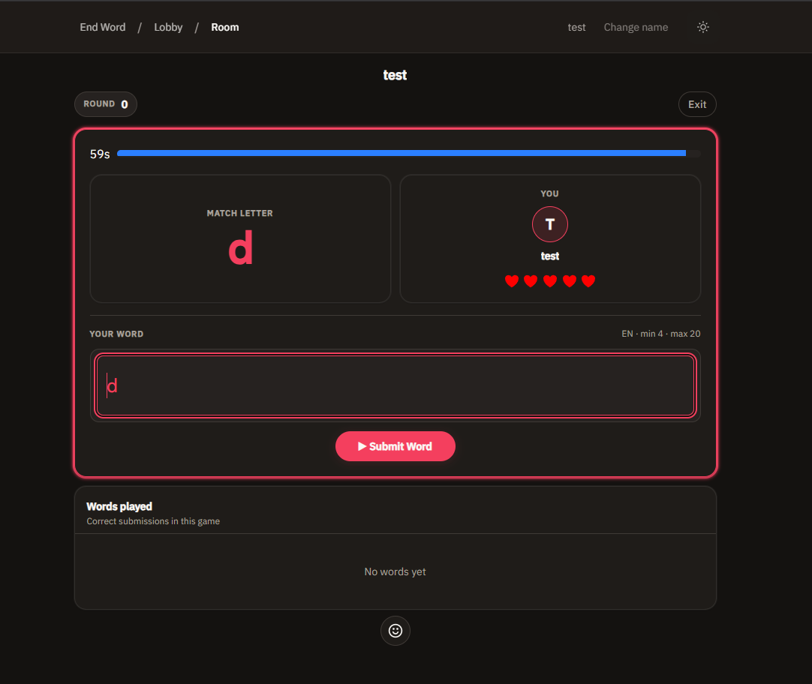

_This is part of the [end-word](/blog/about-end-word) project - a multiplayer word game built with React and Supabase._

<div class="ai-summary" markdown="1">
Building a paused/resumed timer bar for the end-word game turned out trickier than expected: per-second state updates were choppy and drifted from the server. The fix was a "custom" dispatch type to group sequential reducer calls, plus switching to `react-timer-hook` for smooth updates and a single source of truth for the timer value sent to the server.
</div>

## timer

i spent two weeks trying to build a timer element for the end-word game. the idea was it would be a horizontal bar, indicating to the user the time they had left on the game screen. the bar would pause when the user is submitting, and pause when it's not their turn.

it turned out to be trickier than i imagined. doing things in the *react* way still requires quite a lot of thought and this was a good way to practise that.

### first attempt

the bar needs to show the remaining time, and it would do that with its length. so 100% width would mean the full amount of time, and every second it would have shrunk by 1%. this should make the logic much simpler, and make for a smoother animation. this seemed simple enough and i built a timer hook and a `TimerBar` component.

```tsx
const width = `${(remaining / total) * 100}%`
return <div className="bar" style={{ width }} />
```

i hit problems immediately:
- the bar was choppy. updating once per second looked like a slideshow.
- the hook's remaining value drifted from what the server expected.
- pausing on "word submitted" vs "turn ended" vs "player died" - each event path had subtle bugs.
- react's batched updates meant the bar and game state got out of sync.

### double dispatch

all game state goes through one `useReducer` - the only way to change it is by dispatching an action. the handler should do one thing per event - validate, then dispatch once. instead it mixed validation with dispatching, firing a `PAUSE_TIMER` and then a conditional `SUBMIT_WORD`:

```tsx
const handleSubmit = () => {
  const isValid = validateWord(word)
  dispatch({ type: 'PAUSE_TIMER' }) // first dispatch
  if (isValid) {
    dispatch({ type: 'SUBMIT_WORD', payload: word }) // second dispatch - batched, order not guaranteed
  }
}
```

react batches the tick, so a `PAUSE_TIMER` outside the conditional and a `SUBMIT_WORD` inside it have no guaranteed order. the resulting state becomes non-deterministic.

the fix i decided was to group all `dispatch` events together. this was important as conceptually it separates updating the game state, and other aspects of the game (i.e. ui, local state). i created the `custom` dispatch type to make it possible to group multiple calls and payloads, and have them execute in sequence:

```tsx
// one dispatch carries the grouped calls + their payloads
dispatch({
  type: "custom",
  payload: [state, ["setPlayerLastWord", "gameStateUpdateClient"], [[word], [state]]],
})

// the reducer runs them in sequence, threading state through each
export function custom(state, reducerFunctions, reducerPayloads) {
  let nextState = state
  for (let i = 0; i < reducerFunctions.length; i++) {
    const reducer = GameStateActions[reducerFunctions[i]]
    nextState = reducer(nextState, ...(reducerPayloads[i] || []))
  }
  return nextState
}
```

a single dispatch handles everything sequentially.

### css animation

i tried width transitions, but the bar stayed choppy. i tried css keyframes, but re-renders kept resetting the animation to 0%.

the real issue was animating a derived value (remaining / total) that changed on every tick. the component re-rendered, the animation restarted, the bar jumped.



### timer library

`react-timer-hook` does exactly what i needed. it updates smoothly and handles pause/resume/reset correctly. the overhead i feared (updating state 60x/sec) is negligible. i removed my own timer implementation outright.

```tsx
const { secondsRemaining, isRunning, pause, resume } = useTimer({
  expiryTimestamp: Date.now() + remaining * 1000,
  onExpire: handleTimeUp,
  autoStart: false,
})
```

my custom implementation was ~200 lines. the library call is 15. it covers every edge case i missed.

### server drift

even with the library, the value sent to the server differed from the value driving the animation.

client: `TimerBar` pauses at remaining = 3.2s → sends 3.2 to server
server: receives 3.2, but client animation continues to 0 over 3.2s
result: animation hits 0 after the server already declared time-up - that's the drift.

the fix was a single source of truth. the timer hook owns the value. the submit handler reads from the hook, not from a separate state variable. the server receives exactly what the bar shows. to note, the timer now also pauses on already-used and too-short words as part of the submission logic.

### rounding

when the timer hits 0, the bar stops at ~2% instead of collapsing to 0%. probably rounding in the width calculation, or the `onExpire` callback fires one tick early. low priority - the game logic works, the ux is 98% there.

### what i learned

the logic for the timer wasn't as simple as i had thought. initially i thought avoiding frequent re-renders was important, so i opted to avoid frequent polling. ultimately using the library was much better than my custom code. it accounted for all the things i needed, even the ones i hadn't even thought of. if i had to do this again from scratch, i would put more thought into how the timer integrates with the entire app, rather than just its own mechanics.