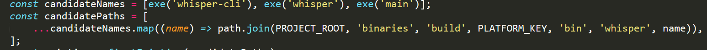

_This is part of the [kakao-agent](/blog/about-kakao-agent) project - a pipeline that transcribes YouTube videos, summarizes them with AI, and posts the result to KakaoTalk._

<div class="ai-summary" markdown="1">
Runs of the post-news quick task were failing at the transcription step with a cryptic whisper error. After adding more detailed logging, the cause turned out to be a misnamed binary: on macOS whisper is `whisper-cli`, but the path resolver was looking for `whisper`. The fix also introduced a concurrency limit for whisper jobs and tidied the class into a singleton.
</div>

## whisper failure

when running the post-news quick task, on the kakao-agent application, the runs were failing at the transcription step giving this error:

```
Error processing video: whisper transcription failed:
whisper_init_from_file_with_params_no_state: loading model from
'binaries\build\win32-x64\models\ggml-base.en.bin'
```

the error wasn't very telling of the issue. reproducing the error was a bit difficult since the job was specific to video id, which were not visible in the logs. so the first step here was to increase the verbosity of the logs by adding the video id to the output. that way a failure can be cross-referenced back to the exact video.

### concurrency limit

i wasn't sure if the failure was memory-related. cpu and mem go to 100% when running `whisper`, and some instances fail under load. so i asked ai to add a concurrency limit.

ai said the logic belongs in the `whisper` class itself, not the post-news quick task. it added a queue similar to the `ollama` class (which handles ai requests with rate limiting so parallel jobs don't get throttled). the queue holds incoming jobs and runs a fixed number at a time instead of letting every instance hammer the machine at once.

when looking at the class i noticed that it should infact be a singleton, as no there was no meaningful state on instantiation.

### solution

after putting in more detailed logging i realised that i caused the error during my previous refactor of `mediaTools`.
i made changes to the `mediaTools` path resolver - how the tool finds the different tools (i.e. ffmpeg, whisper, yt-dlp). the class was looking for the binary `whisper`, however on mac it's called `whisper-cli`. because of this the class couldn't find `whisper` and caused the job to fail.

i also learned that ai likes the pattern of "candidate names" and "candidate paths" when working with external paths.

 