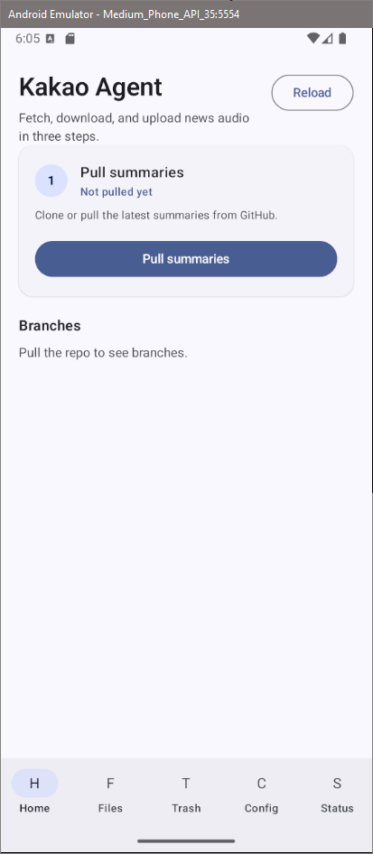
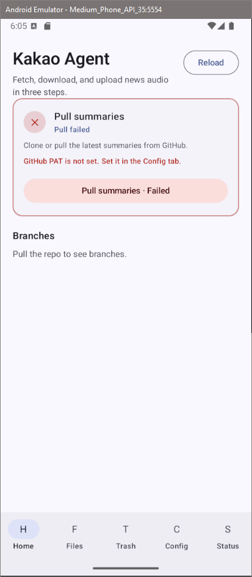
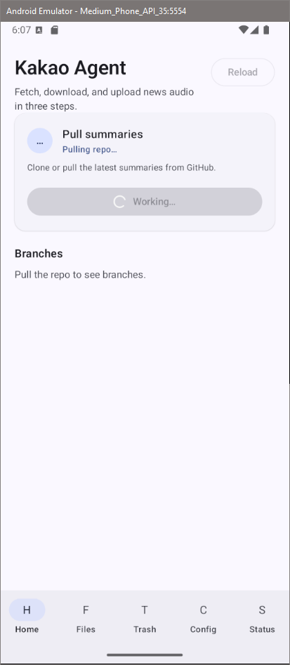
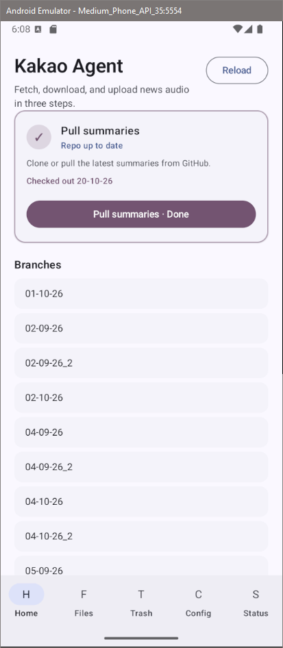

_This is part of the [kakao-agent](/blog/about-kakao-agent) project - a pipeline that transcribes YouTube videos, summarizes them with AI, and posts the result to KakaoTalk._

<div class="ai-summary" markdown="1">
The android app's job is to pull summary files from git (pushed by the desktop app), copy them to the phone, and hand them off to Termux for sending. Getting git working inside the app with JGit hit two problems: the JVM ran out of memory (2 GB heap wasn't enough), and cloning failed due to token/auth issues. The token problem turned out to be a trailing whitespace in the token string.
</div>

## android git role

the android app's role is to pull summary files from git (where the desktop app pushes them), copy them to a folder on the phone, and hand them off to termux for sending via agent-messenger.

to do this, the app needs to clone a git repo inside the android app data directory using `jgit`.

### jvm memory

i had ai implement git pull, but then the app stopped building. there were no obvious errors. i used ai to troubleshoot and it turns out that the jvm ran out of memory. 2gb heap wasn't enough for jgit.

### cloning

when working on the refactor for the `news` service, which involved making a big monolith process modular, one part i added was support to push the created news summaries to a remote github branch. the logic involved cloning the repo, creating an orphan empty branch, populating it with the files, then pushing it.

when working on that, i faced a 403 error when using `simple-git` to clone the repository. my PAT token was valid but i still got permission errors. after some searching i realised that the solution was to add the PAT to the request header in this format:

```typescript
const git = simpleGit().addConfig(
  "http.https://github.com/.extraheader",
  `Authorization: Bearer ${token}`
);
```

so when i faced a similar issue with the repository not cloning when using `JGit` on the android application, i tried to add a similar header. however the two libraries seemed to handle git differently - `simple-git` was a wrapper around `git`, whilst `JGit` was a java implementation of git.

i spent a while trying different things:
  - double/triple/quadruple checking the token permissions on git
  - realised that i actually set the wrong repository for permission with the fine grained token, and changed that. but still didn't fix the issue

i then tried to use a classic github token, and that actually worked. at this point i was testing using a standalone kotlin script, rather than on the app since it was easier.

however, when implementing it on the android application, it again stopped working. it worked with the standalone script but not when in the android application.

given how little i knew about the android system, i had no idea what could possibly be causing this. was there some android restriction that i don't know about? is there a bug in the implementation? i also was not very familiar with the tooling around debugging android applications, which was frustrating me even more.

after sometime, i thankfully noticed that the issue was due to human error. i had an extra whitespace at the end of the token string...





