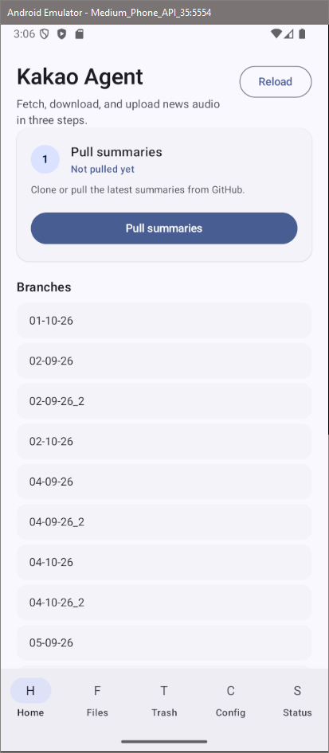
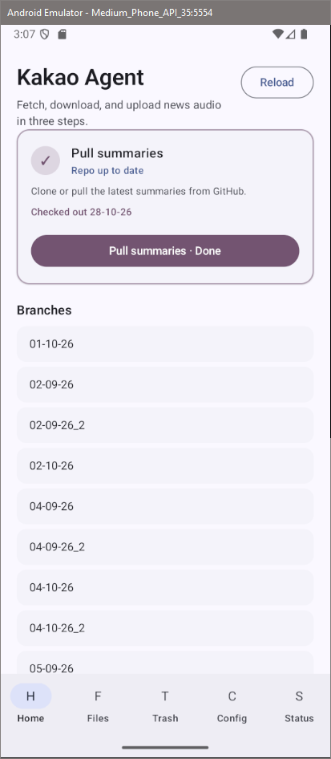
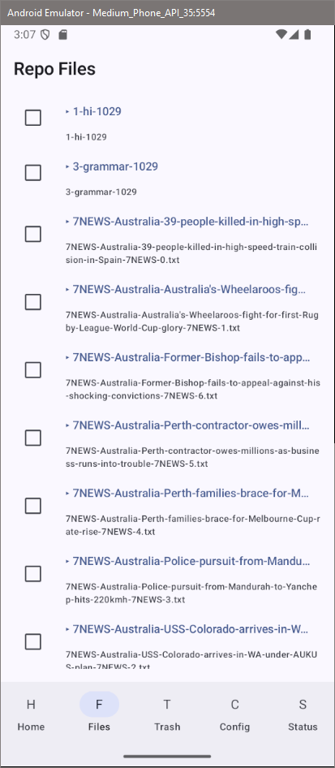
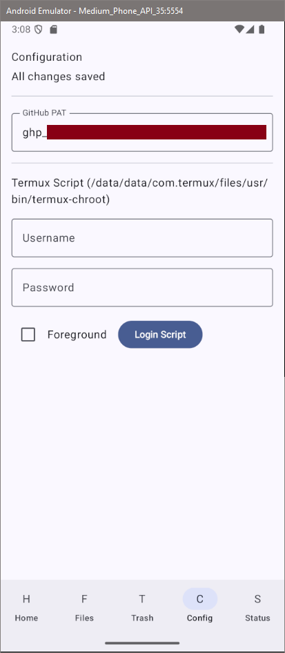

_This is part of the [kakao-agent](/blog/about-kakao-agent) project - a pipeline that transcribes YouTube videos, summarizes them with AI, and posts the result to KakaoTalk._

## what it is

as part of the kakaotalk messaging automation, there was a need to manage files and configurations on the mobile side. for that, i had ai build an app. the primary function of the app is to ensure the phone has the right files which contain the messages to be automatically pushed. it does this by pulling the latest github branch of a specific repository, to which files are pushed to. the application also provides a graphical interface to authenticate with `agent-messenger` - every few days the authentication expires so the current workaround is to manually redo it.

the app is just called `KakaoAgentApp3` for now.

## why it exists

the automation for sending kakaotalk messages requires the messages to be on disk as text files. the files are generated using the kakao-agent application. i opted to use github as a way to sync the files, so that the app on the phone just needs to pull the branch to get the latest files.

## how it works

the app is built by ai - it uses jetpack compose in kotlin. `JGit` is the library for managing the git actions, and `agent-messenger` login is done through the termux `RUN_COMMAND` activity.

the repo is cloned to the application's private data folder, then copied to a shared folder. changes to the files (delete/restore) are mirrored.

## progress

the next step is to add a way to automate the branch pulling - ai added an activity which can then be invoked using `am` from an external script, however i'm facing an issue where it seems as if `git` cannot pull when the running application is in the background - throwing an error.

*it's possible to switch between branches. also the flavour text hasn't been updated lol.*

*there is file management, however this isn't really used as much as i thought it would be. instead the files are manually deleted when necessary*

*the config screen where credentials can be saved, to one-click complete auth with `agent-messenger`. the screen also reads the output of `agent-messenger auth login` for the passcode value, and shows it on screen for the user to type into kakaotalk*