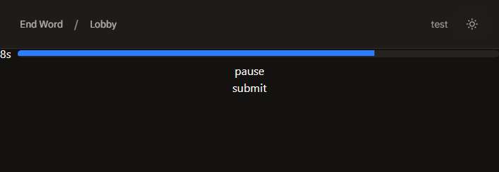
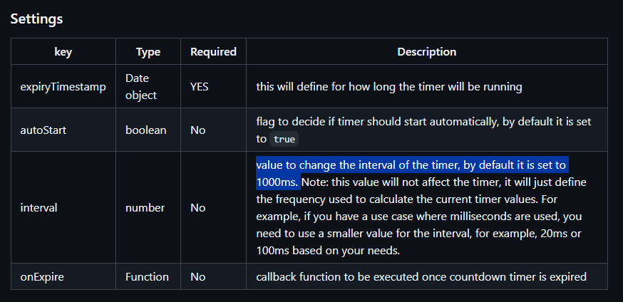

_This is part of the [end-word](/blog/about-end-word) project - a multiplayer word game built with React and Supabase._

## the bug

i haven't touched the end-word project in quite some time - however i still have the live version hosted on vercel. i wanted to record some gameplay to put on my github project, when i stumbled on a bug...

there are two bugs i noticed, both related to the timer bar during the main gameplay screen:
- the timerbar would randomly freeze for  a few seconds, then suddenly jump to the position it should be at
- when submitting between 1s and 0s remaining, the game would not register the submission and instead the player would die due to not submitting on time

at first i was filled with dread... not *another* thing to fix, on top of the every growing list of things to do...

after a while, i started to look through the code and remind myself what things look like. my first attempt was met with overwhelm. the application isn't objectivley *that* big, however just trying to think about all the different components, networking, states etc... made my head hurt. i wasn't sure where to start, and the thought the fact that this could turn into a nightmare troubleshooting session, made me not even want to look into it.

after some brief browsing, i decided to leave it be and return to it later the day.

some hours later, i decided to hop on into the codebase. in the time away, i thought that one means of troubleshooting could be to isolate the `TimerBar` component and see how that goes. i have a `/foo` route setup for doing just that. as i was jumping around the references to `TimerBar` to see what the props were, the first issue stood out very clear.

```typescript
export default function TimerBar({ timer, isSubmitting }: TimerBarProps) {
	// ...
	const animationPaused = isSubmitting || timer.isPaused;
	/// ...
	return (
		<>
			// ...
			className={`w-full h-2 ${animationPaused ? "bg-gray-500" : "bg-blue-500"} origin-left`}
			// ...
			animationPlayState: animationPaused ? "paused" : "running"
			// ...
		</>
	);
}
```

there are two values, which seemingly do the same thing - control whether the timer is paused or not. i didn't think too much more about it.

i blindly started implementing it under a dummy test page, copying over the parameters and properties.



the `pause` button was to pause the timer, and the `submitting` button was to simulate when the submission is pending, and the time is paused.
i messed around with the buttons and noticed that the `submitting` button would stop the animation, but the timer would still be running.

returning back to the component, i looked to see how things are wired. after a bit, i noticed how obvious the bug i.
the `isSubmitting` value is a simple boolean, which has nothing to do with the actual `Countdown` object, however the first prop of the componentis a `Countdown` object, whose `isPaused` property is state that controls the timer itself.

after spending a little while reflecting on how silly this was, the next thought was how to fix this, whilst making the least amount of changes.
the `isSubmitting` variable did hold semantic value, as it indicated a specific state and usecase in the game logic, so just removing it didn't seem like the correct move.
rather i needed to move it out to where the `Countdown` object (which is passed to the props) is created and configured.

```typescript
const countdown = useCountdown(
	gameState.timerDuration,
	gameState.status,
	// isTimerPaused,
	isTimerPaused || isSubmitting,
);
```

relived that this was an easy fix, i start the game up locally and monitor for two things:
- did the random freezes stop
- does the game still break when submitting a few milliseconds before 0s

to my disappointment, submitting between 1s and 0s still had the same result.
to troubleshoot, i thought to add the numeric value of the timer, see what's actually going on - and that's when it all cleared up.

the timer was counting down in intervals of roughly 1000ms, which is every second. meaning, submission that occurs within that one second is never registered.



now it all made sense - i google to see what the average range of human reaction speed is. the lowewer bound seemed to be 100ms, so i set the interval to 90ms.

## conclusion

at the end of teh day, the fix was very simple and the errors were very obvious. compared to the intial dread i felt about this, the work turned out to be much simpler than anticipated.
