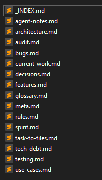

_This is part of the [end-word](/blog/about-end-word) project - a multiplayer word game built with React and Supabase._

<div class="ai-summary" markdown="1">
After switching from Cursor to opencode, agent code quality dropped: models missed context and broke things even on small edits. Dumping project knowledge into harness files (`_INDEX.md`, `rules.md`) sped up understanding and modestly improved quality, but didn't fix testing. The harness also documents gotchas and module boundaries to keep the mental model stable as AI refactors the codebase.
</div>

## the harness

after i stopped using cursor for opencode, the quality of the code was awful. models failed to understand things cursor understood phrased the same way. they didn't run checks after making edits - even small edits would break things. they had a very narrow understanding of the context code chunks lived in.

following some googling, i learnt that the robustness of the harness plays a huge part in its output. so i spent a while dumping everything in my head into files. it was a long back-and-forth: I walked through the high-level features one by one, dug into each, had the agent ask me things, checked it understood what i told it, then had it document them into files. did that again and again.

i had gpt generate the prompts to initiate the documenting. i didn't write any of the files - i wanted ai to write them so hopefully it writes in a way it best understands. i just fed lots of information and had it ask me things iteratively.

the change was minimal. the only real change was it got faster at understanding the project. code quality improved slightly, as the harness added rules tackling common issues i kept facing. recent work added `LogLayer` structured logging across the game components, which helps trace what's happening. but it didn't solve the testing problem. better code still needs tests. and tests need understanding - the one thing i don't really have.



`_INDEX.md` is the entry point, it contains the most important top level aspect of the project. for the agent, this is a brownfield project. meaning it's difficult for the ai to get a firm grasp of how the project is, and what the project is about. including the semantics of different parts of the code. these difficulties come up when i use agents to work on the codebase. i use this file to cement aspects of the codebase which the agent previously stumbled on - this is especially important as i'm rotating between several models.

```markdown
## 3 Critical Conventions

1. **Module boundaries are strict**:
   - `src/shared/` — Pure logic. No React, no Node imports. GameState reducer, types, utils, consts.
...

2. **Logging: two systems, know which one**:
...

3. **Auth is two-tier** (`src/proxy.ts` handles all gating):
...

## 5 Most Common Gotchas
...

## Quick-Ref: Key Files

| Concern | File |
|---------|------|
| Auth gate (every request) | `src/proxy.ts` |
| Game state reducer | `src/shared/GameState.ts` |
| Status transitions | `src/shared/gameStatus.ts` |
| Main gameplay UI | `src/app/components/game/GameV2.tsx` |
...

```

i also have a dedicated `rules.md` to address critical behaviours by the agent, which are detrimental to the project development.
```markdown
# Rules

Hard constraints. No exceptions without explicit approval.

## R1: Never import server code into client components
...

## R2: Prefer existing state patterns before creating a new store
...
```

these are also important for me to try maintain my understanding of the codebase. since ai code changes can often radically alter the codebase from the mental model i have, to something else - this happening makes developing and maintaining the project very difficult.